<div align="center">



<br/>

<a href="https://www.linkedin.com/in/maphuquy24072004"></a>
<a href="https://quyzzma.github.io"></a>
<a href="mailto:maphuquy2134@gmail.com"></a>
<a href="https://github.com/QuyzzMa?tab=repositories"></a>

</div>

<br/>


<br/><br/>




<br/><br/>


<table align="center">
<tr>
<td width="50%"><a href="https://github.com/QuyzzMa/olist-elt"></a></td>
<td width="50%"><a href="https://github.com/QuyzzMa/retail-data-warehouse-mysql"></a></td>
</tr>
<tr>
<td width="50%"><a href="https://github.com/QuyzzMa/Global_Ecommerce_Sales"></a></td>
<td width="50%"><a href="https://quyzzma.github.io"></a></td>
</tr>
</table>

<p align="center"><sub><a href="https://github.com/QuyzzMa?tab=repositories">→ xem tất cả repositories</a></sub></p>

<br/>


<br/><br/>


<br/><br/>




<p align="center"><sub>▾ bấm vào từng chứng chỉ để xem bản gốc</sub></p>

<details>
<summary><code>✓ PASSED</code>&nbsp; <b>Google Data Analytics Professional Certificate</b> <sub>· Google · Coursera</sub></summary>
<br/>
<p align="center"><a href="https://www.coursera.org/account/accomplishments/professional-cert/certificate/6YXSU3REQCV5"></a><br/><sub>ID 6YXSU3REQCV5 · <a href="https://www.coursera.org/account/accomplishments/professional-cert/certificate/6YXSU3REQCV5">xác minh trên trang nhà cấp ↗</a></sub></p>
</details>

<details>
<summary><code>✓ PASSED</code>&nbsp; <b>Meta Data Analyst Professional Certificate</b> <sub>· Meta · Coursera</sub></summary>
<br/>
<p align="center"><a href="https://www.coursera.org/account/accomplishments/professional-cert/certificate/EHKV5G1FTIKI"></a><br/><sub>ID EHKV5G1FTIKI · <a href="https://www.coursera.org/account/accomplishments/professional-cert/certificate/EHKV5G1FTIKI">xác minh trên trang nhà cấp ↗</a></sub></p>
</details>

<details>
<summary><code>✓ PASSED</code>&nbsp; <b>Master Microsoft Power BI: From Beginner to Data Analyst Pro</b> <sub>· Udemy · 01/2026</sub></summary>
<br/>
<p align="center"><a href="https://www.udemy.com/certificate/UC-72fe8ba9-5041-4ade-89a1-9b42a043bf2c/"></a><br/><sub>ID UC-72fe8ba9 · <a href="https://www.udemy.com/certificate/UC-72fe8ba9-5041-4ade-89a1-9b42a043bf2c/">xác minh trên trang nhà cấp ↗</a></sub></p>
</details>

<details>
<summary><code>✓ PASSED</code>&nbsp; <b>Certified Data Analyst Foundations Course</b> <sub>· Udemy · 01/2026</sub></summary>
<br/>
<p align="center"><a href="https://www.udemy.com/certificate/UC-466db07c-5114-44d8-af45-ae05fa38fe9e/"></a><br/><sub>ID UC-466db07c · <a href="https://www.udemy.com/certificate/UC-466db07c-5114-44d8-af45-ae05fa38fe9e/">xác minh trên trang nhà cấp ↗</a></sub></p>
</details>

<details>
<summary><code>✓ PASSED</code>&nbsp; <b>Microsoft Excel Data Analysis and Pivot Tables</b> <sub>· Udemy</sub></summary>
<br/>
<p align="center"><a href="https://www.udemy.com/certificate/UC-8c0c1375-c27f-48df-9d6c-3f694938097a/"></a><br/><sub>ID UC-8c0c1375 · <a href="https://www.udemy.com/certificate/UC-8c0c1375-c27f-48df-9d6c-3f694938097a/">xác minh trên trang nhà cấp ↗</a></sub></p>
</details>

<details>
<summary><code>✓ PASSED</code>&nbsp; <b>Python (Basic) Certificate</b> <sub>· HackerRank · 10/2025</sub></summary>
<br/>
<p align="center"><a href="https://www.hackerrank.com/certificates/6499b222167b"></a><br/><sub>ID 6499B222167B · <a href="https://www.hackerrank.com/certificates/6499b222167b">xác minh trên trang nhà cấp ↗</a></sub></p>
</details>

<details>
<summary><code>✓ PASSED</code>&nbsp; <b>SQL (Intermediate) Certificate</b> <sub>· HackerRank · 10/2025</sub></summary>
<br/>
<p align="center"><a href="https://www.hackerrank.com/certificates/ce87ce3dfe5f"></a><br/><sub>ID CE87CE3DFE5F · <a href="https://www.hackerrank.com/certificates/ce87ce3dfe5f">xác minh trên trang nhà cấp ↗</a></sub></p>
</details>

<br/><br/>


<table align="center" border="0">
<tr>
<td width="50%" valign="top"></td>
<td width="50%" valign="top"></td>
</tr>
</table>

<br/>


<details>
<summary><code>▸ SELECT * FROM quy.secrets;</code> <sub>← bấm để chạy</sub></summary>

```json
{
  "status": 200,
  "data": {
    "availability": "Open to Data Engineer Fresher / Intern",
    "based_in": "TP. Hồ Chí Minh",
    "favorite_stack": ["SQL", "Python", "MySQL", "Power BI"],
    "pipeline_motto": "Chạy lại bao nhiêu lần cũng không mất, không trùng",
    "contact": "maphuquy2134@gmail.com"
  }
}
```

<sub>✓ 1 row returned · 0 rows rejected · reconciliation OK</sub>

</details>

<br/>


