<div align="center">


<br/>

<a href="https://www.linkedin.com/in/maphuquy24072004"></a>
<a href="https://quyzzma.github.io"></a>
<a href="mailto:maphuquy2134@gmail.com"></a>
<a href="https://github.com/QuyzzMa?tab=repositories"></a>

</div>

<br/>




<br/><br/>


<br/><br/>


<table align="center">
<tr>
<td width="50%"><a href="https://github.com/QuyzzMa/olist-elt"></a></td>
<td width="50%"><a href="https://github.com/QuyzzMa/retail-data-warehouse-mysql"></a></td>
</tr>
<tr>
<td width="50%"><a href="https://github.com/QuyzzMa/Global_Ecommerce_Sales"></a></td>
<td width="50%"><a href="https://quyzzma.github.io"></a></td>
</tr>
</table>

<p align="center"><sub><a href="https://github.com/QuyzzMa?tab=repositories">→ xem tất cả repositories</a></sub></p>

<br/>




<br/><br/>




<br/><br/>


<br/><br/>


<table align="center" border="0">
<tr>
<td width="50%" valign="top"></td>
<td width="50%" valign="top"></td>
</tr>
</table>

<br/>


<details>
<summary><code>▸ SELECT * FROM quy.secrets;</code> <sub>← bấm để chạy</sub></summary>

```json
{
  "status": 200,
  "data": {
    "availability": "Open to Data Engineer Fresher / Intern",
    "based_in": "TP. Hồ Chí Minh",
    "favorite_stack": ["SQL", "Python", "MySQL", "Power BI"],
    "pipeline_motto": "Chạy lại bao nhiêu lần cũng không mất, không trùng",
    "contact": "maphuquy2134@gmail.com"
  }
}
```

<sub>✓ 1 row returned · 0 rows rejected · reconciliation OK</sub>

</details>

<br/>


