 

 

Đang phát triển: <a href="https://github.com/QuyzzMa/ResumeIQ"><b>ResumeIQ</b></a> — đối chiếu CV với JD dựa trên bằng chứng (Python) · <a href="https://quyzzma.github.io">Portfolio</a> · <a href="https://github.com/QuyzzMa?tab=repositories">Tất cả repositories</a>

 

 

