<div align="center">


<br/>

<a href="https://www.linkedin.com/in/maphuquy24072004"></a>
<a href="https://quyzzma.github.io"></a>
<a href="mailto:maphuquy2134@gmail.com"></a>
<a href="https://github.com/QuyzzMa?tab=repositories"></a>

</div>

<br/>



<br/><br/>


<table align="center">
<tr>
<td width="50%"><a href="https://github.com/QuyzzMa/Global_Ecommerce_Sales"></a></td>
<td width="50%"><a href="https://github.com/QuyzzMa/olist-elt"></a></td>
</tr>
<tr>
<td width="50%"><a href="https://github.com/QuyzzMa/retail-data-warehouse-mysql"></a></td>
<td width="50%"><a href="https://github.com/QuyzzMa/ResumeIQ"></a></td>
</tr>
</table>

<p align="center"><sub><a href="https://quyzzma.github.io">portfolio</a> · <a href="https://github.com/QuyzzMa?tab=repositories">tất cả repositories</a></sub></p>

<br/>



<br/><br/>


<br/><br/>



<br/><br/>


<p align="center">
<a href="https://s3.amazonaws.com/coursera_assets/meta_images/generated/CERTIFICATE_LANDING_PAGE/CERTIFICATE_LANDING_PAGE~6YXSU3REQCV5/CERTIFICATE_LANDING_PAGE~6YXSU3REQCV5.jpeg"></a>
<a href="https://s3.amazonaws.com/coursera_assets/meta_images/generated/CERTIFICATE_LANDING_PAGE/CERTIFICATE_LANDING_PAGE~EHKV5G1FTIKI/CERTIFICATE_LANDING_PAGE~EHKV5G1FTIKI.jpeg"></a>
<br/>
<a href="https://udemy-certificate.s3.amazonaws.com/image/UC-72fe8ba9-5041-4ade-89a1-9b42a043bf2c.jpg"></a>
<a href="https://udemy-certificate.s3.amazonaws.com/image/UC-466db07c-5114-44d8-af45-ae05fa38fe9e.jpg"></a>
<br/>
<a href="https://www.hackerrank.com/certificates/6499b222167b"></a>
<a href="https://www.hackerrank.com/certificates/ce87ce3dfe5f"></a>
<br/>
</p>

<br/>


<table align="center" border="0">
<tr>
<td width="50%" valign="top"></td>
<td width="50%" valign="top"></td>
</tr>
</table>

<br/>


<details>
<summary><code>▸ git show quy:about.json</code> <sub>← bấm để xem</sub></summary>

```json
{
  "looking_for": "Entry-level Data role — Data Analyst / BI / Data Engineer",
  "still_deciding": "DA hay DE — chọn dựa trên bằng chứng từ dự án thật",
  "also_running": "BaLi Services — website, thiết kế, thẻ NFC, digital marketing",
  "interests": ["AI agents", "automation", "Facebook data extraction", "video processing"],
  "principle": "Không ghi vào hồ sơ điều mình chưa thật sự làm"
}
```

</details>

<br/>


